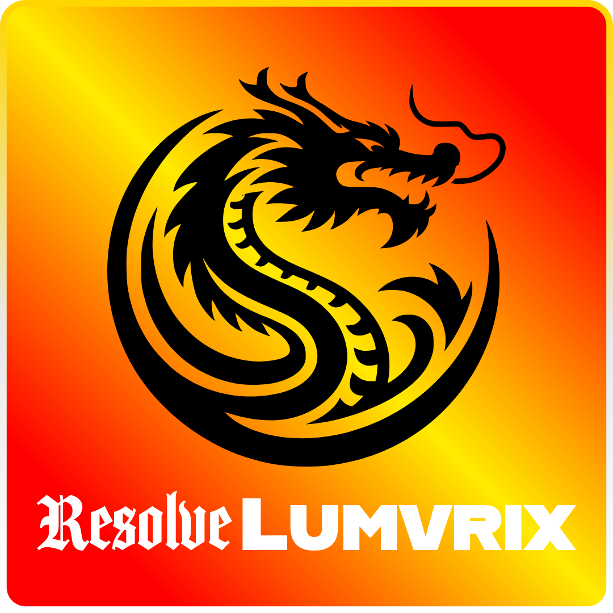

# Resolve Lumvrix™ — Official Intellectual Property, Trademark & Patent Rights Notice

  

**Product Name:** **Resolve Lumvrix™** *(v4.1.0, powered by the STA-6 2K Engine)*  
**Exclusive Corporate Owner:** **HRL International Private Limited** (*HRL International Pvt. Ltd.*)  
**Registered Office:** Mangaluru, Dakshina Kannada, Karnataka – 575007, India  
**Founder & Managing Director:** Pavan Kumar Sadashiv  
**Official Legal & Licensing Contact:** `hrlinternationalprivatelimited@gmail.com`  
**Effective Date:** November 22, 2026  

---

## 1. Exclusive Ownership Declaration
The software name **Resolve Lumvrix™**, the official **`RL` Dragon Emblem (`rl.png`)**, all software architecture, user interface designs, zero-lag 60fps Canvas editing harness code, AI Bridge MCP protocol implementations, FFmpeg/Pillow rendering engines, and pre-trained machine learning weights are the **sole and exclusive intellectual property of HRL International Private Limited (`HRL International Pvt. Ltd.`)**.

No third party, licensee, contributor, or user acquires any ownership interest, trademark right, or patent license in **Resolve Lumvrix™** or its underlying technologies except the narrow commercial end-user execution rights granted in [`LICENSE`](LICENSE).

---

## 2. Trademark & Brand Asset Ownership
- **Protected Marks:** **`Resolve Lumvrix™`**, **`Resolve Lumvrix`**, **`HRL™`**, **`HRL International™`**, and the official **`RL` Dragon Emblem (`docs/assets/rl.png` / `harness/assets/rl.png`)**.
- **Covered NICE Classifications:**
  - **Class 9:** Downloadable computer software, video editing studios, GPU rendering pipelines, AI agent MCP bridges, and caption synthesis engines.
  - **Class 38:** Digital video streaming, content publishing, and media distribution tooling.
  - **Class 41:** Creator media production, editing education, and digital entertainment workflows.
  - **Class 42:** Enterprise SaaS, browser-based video editing harnesses, artificial intelligence research, and multimodal ML scoring engines.
- **Statutory Basis:** Protected under common-law prior use, the **Trade Marks Act, 1999 (India)** (including passing-off and Sections 103/104 remedies), and applicable international frameworks including the **WIPO Madrid System**.
- **Prohibited Use:** Any unauthorized use of the name **"Resolve Lumvrix"** (or confusingly similar variations) or the **`rl.png`** emblem in software, domains, repositories, marketing, or competing tools is strictly prohibited.

---

## 3. Patent Rights & Proprietary Technical Inventions Reservation
**HRL International Pvt. Ltd.** expressly reserves all domestic and international **patent filing, priority, continuation, and enforcement rights** under the **Patents Act, 1970 (India)**, the **Patent Cooperation Treaty (PCT)**, and corresponding international patent statutes for the novel technical systems embodied in **Resolve Lumvrix™**, including:

1. **Zero-Gap Flush Edge-to-Edge Split-Screen 2K Video Compositor:** Automated source letterbox/OBS header stripping (`detect_top_black_bar`) combined with single-pass anti-blur Lanczos + AMD FidelityFX CAS restoration and flush zero-gap vertical composition (`816px + 1744px = 2560px` @ 2K 60fps) enforcing deterministic seam luma invariants.
2. **Zero-Lag 60fps Browser Editing Harness with Direct Seam-Snapping & Spatial Review Flagging:** Single-file Canvas 2D real-time preview architecture with direct on-canvas caption manipulation, magnetic flush-seam snapping, inline spatial `(x, y, t)` pin flagging, and deterministic quality gates (`β = 1`).
3. **Two-Way Atomic JSON-RPC 2.0 AI Bridge MCP Architecture (`resolve-lumvrix`):** Zero-dependency Model Context Protocol server providing live bi-directional state synchronization (`harness_state.json`), non-destructive timeline snapshot diffing (`preview_timeline` / `compare_timelines`), and fail-closed `OPEN_FLAGS_CLEAR` render gating across autonomous AI coding agents.
4. **4:4:4 RGB Color-Corrected Live-Footage Inverted Caption Compositor & Ink-Bounding-Box Motion Typography:** Artifact-free `gbrp` `negate + eq + maskedmerge` inverted captions, 15fps circular erode-dilate stop-motion captions, and glyph-ink bounding-box optical centering.
5. **137-Channel Tri-Stage Multimodal Pairwise Viral Ranking Engine:** Leak-free packaging ensemble, within-channel Bradley-Terry pairwise RankNet, and Gold-Standard centroid verification.

> **Statutory Accuracy Note:** This notice records prior invention, authorship, trade-secret confidentiality, and exclusive reservation of patent rights by **HRL International Pvt. Ltd.** Official statutory patent numbers and `®` symbols will be appended upon formal registration/grant by the Office of the Controller General of Patents, Designs and Trade Marks (IP India), USPTO, and WIPO.

---

## 4. Copyright, Trade Secrets & DMCA Enforcement
- **Copyright:** `Copyright © 2026 HRL International Private Limited (HRL International Pvt. Ltd.). All Rights Reserved.`
- **Statutes:** Protected under the **Indian Copyright Act, 1957** (Sections 63, 64, and 65A Anti-Circumvention), the **Berne Convention**, the **Information Technology Act, 2000** (Sections 43, 66, and 66C), and **17 U.S.C. § 512 (DMCA)**.
- **DMCA & Infringement Reporting:** Send formal infringement, licensing, or takedown notices to **`hrlinternationalprivatelimited@gmail.com`**.
- **Governing Jurisdiction:** Courts of Mangaluru, High Court of Karnataka (India), and WIPO Arbitration Center.

---

**BY ORDER OF THE BOARD OF DIRECTORS**  
**Pavan Kumar Sadashiv** — Founder & Managing Director  
**HRL International Private Limited (`HRL International Pvt. Ltd.`)**
