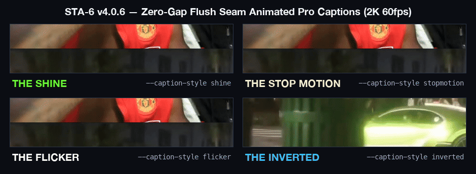
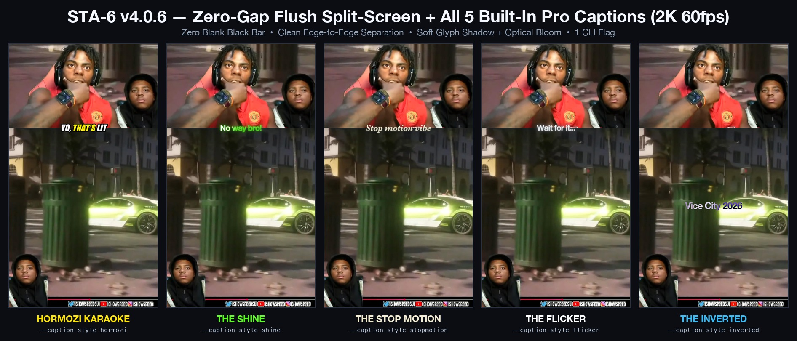
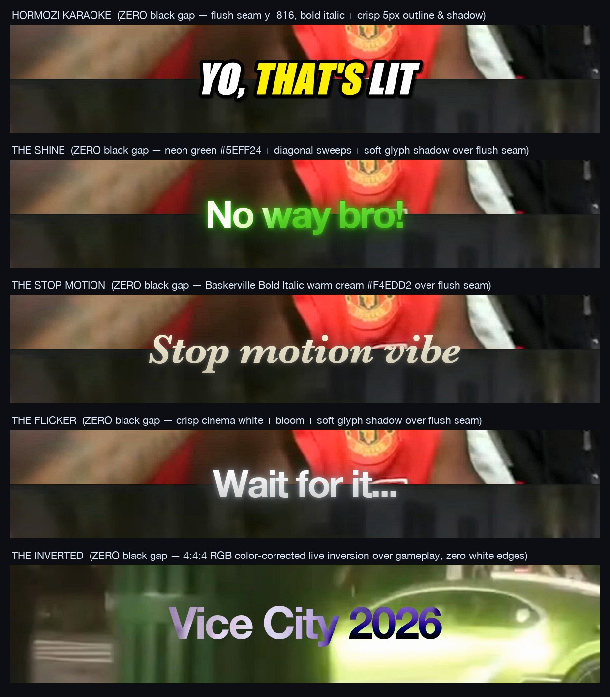
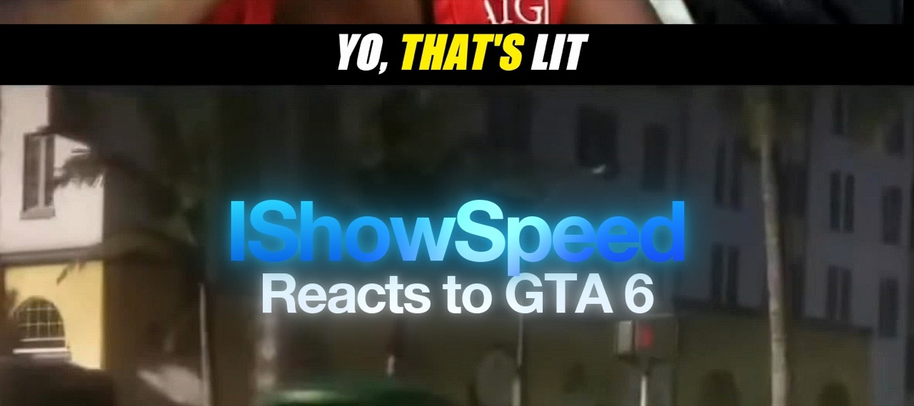
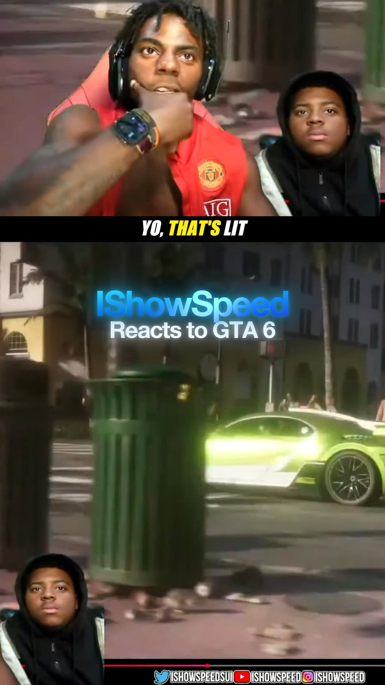

<p align="center">
  <a href="https://whop.com/checkout/plan_fOxPHqsLK2LxS">
    
  </a>
</p>

<p align="center">
  <a href="https://whop.com/checkout/plan_fOxPHqsLK2LxS">
    
  </a>
  <a href="https://whop.com/agensi/sta-6/">
    
  </a>
  <a href="https://whop.com/agensi/sta-6/">
    
  </a>
</p>

# STA 6 — Signal Theft Auto VI (v4.0.6 Zero-Gap Flush Split-Screen + 5 Pro Motion Captions + 2K Autopilot)

> **50% OFF Launch Offer (First 50 Clippers Only):** Enter promo code **`STA650`** at Whop checkout to drop the Lifetime License from ~~`$49`~~ to **`$24.50` one-time** (no monthly fees).
>
> **Paid Source Code & Pre-Trained ML Engine:** The full `STA 6 v4.0.6` Python pipeline, flush zero-gap split-screen renderer, 5 zero-editor pro motion caption styles (`clip.py captions`), 60fps Animated Viral Shine Hook generator, Zero-Loss 2K anti-blur engine, pre-trained 137-channel Tri-Stage ML weights (`models/viral_model_v4.json`), and automation skill are **private** and unlock **immediately upon purchase on Whop**.

---

## Get Instant Access — ~~`$99`~~ ~~`$49`~~ **`$24.50` with code `STA650` (Lifetime License)**

No monthly subscription. Pay once via **Whop** (Card, Apple Pay, Google Pay, local-currency adaptive pricing):

### **[Claim 50% OFF on Whop (Code: `STA650` → `$24.50` One-Time) →](https://whop.com/checkout/plan_fOxPHqsLK2LxS)**

**How instant delivery works after payment:**
1. **Immediate Download Inside Whop:** The second your payment completes, Whop automatically unlocks the private **STA 6 v4.0.6 — Download & Setup** hub containing **`STA-6-v4.0.6.zip`** and the 60-second macOS Apple Silicon setup guide.
2. **Private GitHub Repo Access (`STA-6-pro`):** Enter your GitHub username at checkout to also receive collaborator access to the private `STA-6-pro` repository for all future `v4.x` updates.
3. **Earn 30% as a Clipper Affiliate:** Share STA 6 through Whop's Global Affiliate program ([whop.com/agensi/sta-6](https://whop.com/agensi/sta-6/)) and earn **`$14.70` per full-price sale**.

---

## What's New in `v4.0.6` — Zero-Gap Flush Split-Screen + 5 Built-In Pro Motion Captions

**Zero blank black gap** between facecam and gameplay (`816px + 1744px = 2560px` flush edge-to-edge separation + automatic OBS letterbox trim). Every caption style renders natively at **2K 60fps (`1440×2560`)** with **soft glyph-hugging contact shadow + `±1px` seam alignment** — selectable in one CLI flag by you or your AI coding agent (Claude Code, Antigravity, Cursor, Codex):

<p align="center">
  
  <br />
  <em>Live 60fps zero-gap motion previews rendered natively by <code>scripts/clip.py</code> — clean flush facecam/gameplay separation with The Shine, The Stop Motion (15fps erode-dilate), The Flicker (neon spline curve), and The Inverted (4:4:4 RGB zero-artifact mask)</em>
</p>

<p align="center">
  
  <br />
  <em>Full 2K (1440×2560 @ 60fps) comparison across all 5 styles — ZERO blank black bar, flush edge-to-edge separation &amp; razor-sharp over-video legibility</em>
</p>

<details>
<summary><b>View 1:1 2K Zero-Gap Seam Close-Ups (All 5 Caption Styles)</b></summary>
<p align="center">
  
</p>
</details>

### Coding-Agent CLI Quick Reference (No External Editing Software)

```bash
# 0. Let any coding agent inspect all 5 styles, colors & templates as JSON
.venv/bin/python scripts/clip.py captions

# 1. The Shine — Neon Green (#5EFF24) + 3 Diagonal Light Sweeps + 3-Layer Optical Bloom
.venv/bin/python scripts/clip.py render "<VIDEO_OR_URL>" --clip 120:150 \
  --cam "iw*0.37:ih*0.43:0:ih*0.56" --caption-style shine --caption-color green --out-dir output

# 2. The Stop Motion — Editorial Serif Italic (#F4EDD2) + 15fps Circular Erode-Dilate Dissolve
.venv/bin/python scripts/clip.py render "<VIDEO_OR_URL>" --clip 120:150 \
  --cam "iw*0.37:ih*0.43:0:ih*0.56" --caption-style stopmotion --caption-color cream --out-dir output

# 3. The Flicker — Cinema White + Exact Neon-Tube Spline Opacity Flicker (233ms)
.venv/bin/python scripts/clip.py render "<VIDEO_OR_URL>" --clip 120:150 \
  --cam "iw*0.37:ih*0.43:0:ih*0.56" --caption-style flicker --caption-color white --out-dir output

# 4. The Inverted — 4:4:4 RGB Color-Corrected Live-Footage Inversion (Zero White Edge Artifacts)
.venv/bin/python scripts/clip.py render "<VIDEO_OR_URL>" --clip 120:150 \
  --cam "iw*0.37:ih*0.43:0:ih*0.56" --caption-style inverted --out-dir output

# 5. Hormozi Karaoke (default) — Bold Italic Impact Electric Yellow Active Word Pop
.venv/bin/python scripts/clip.py render "<VIDEO_OR_URL>" --clip 120:150 \
  --cam "iw*0.37:ih*0.43:0:ih*0.56" --caption-style hormozi --out-dir output
```

> **Supported `--caption-color` presets:** `auto` | `green` (`#5EFF24`) | `blue` (`#2ECEFF`) | `cream` (`#F4EDD2`) | `gold` (`#FFD830`) | `pink` (`#FF4CAC`) | `white` (`#FFFFFF`)

---

## `v4.0.4` — Animated Viral Shine Hook Preview

See the **60fps Animated Viral Shine Text** (`--hook "..." --hook-theme blue|vice|gold`), **pixel-centered black caption lane**, and **zero-blur 2K (`1440×2560`) anti-blur facecam output**:

<p align="center">
  
  <br />
  <em>60fps Animated Viral Shine Hook (4-color gradient + diagonal glossy light sweep + pulsing ambient bloom — themes: <code>blue</code>, <code>vice</code>, <code>gold</code>)</em>
</p>

<table>
  <tr>
    <td align="center" width="58%">
      
      <br />
      <b>v4.0.3 + v4.0.4 Typography Close-Up</b><br />
      <sub>Pixel-centered caption bar + auto OBS letterbox trim + zero-border Viral Shine Hook</sub>
    </td>
    <td align="center" width="42%">
      
      <br />
      <b>Full 2K (1440×2560 @ 60fps) Master</b><br />
      <sub>4K VOD ingestion + AMD CAS anti-blur facecam + CRF 13 BT.709 (triggers YouTube VP9/AV1)</sub>
    </td>
  </tr>
</table>

---

## Built for GTA 6 & Streamer Clipping Channels

Trained on **2,193 real YouTube Shorts across 137 unique channels**, **139 paired within-channel Viral vs. Flop MP4s across 37 channels** (zero subscriber bias), **18 Gold-Standard viral Shorts (`100K–11.08M` views)**, **475 long-form RPM benchmarks**, and **270 mined viral comments**.

| Module Included in Paid Package | What It Does for Clippers |
| :--- | :--- |
| **NEW `v4.0.6` Zero-Gap Flush Split-Screen + 5 Pro Motion Captions** | Clean flush edge-to-edge separation (**zero blank black bar**, `816+1744` @ 2K + auto OBS letterbox trim) + built-in `hormozi`, `shine`, `stopmotion` (15fps erode-dilate), `flicker` (spline neon curve), and `inverted` (4:4:4 RGB zero-artifact mask) with soft glyph shadows + `clip.py captions` JSON selector |
| **`v4.0.4` 60fps Animated Viral Shine Hooks** | Premiere-grade two-tier tight neo-grotesque lockup, **4-color bilinear gradient** (`blue` / `vice` / `gold`), animated `-28°` feathered **diagonal glossy shine sweep**, pulsing bottom-stack **ambient bloom glow**, and staggered 60fps pop-in — **zero boxes, zero borders** |
| **`v4.0.2` Zero-Loss 2K Anti-Blur Engine** | Defaults to **`1440×2560 @ 60fps` (`CRF 13`, `320k` AAC, `BT.709`)** to trigger YouTube's high-bitrate **VP9/AV1** tier, downloads up to **4K (`2160p`)** VODs, strips webcam macroblocks (`deblock` + `hqdn3d`) + **AMD FidelityFX CAS** sharpening (**5.9× sharper facecams**), zero double-encoding |
| **Tri-Stage Viral AI Gate (`v4.0.1`)** | **Model A** (`0.7768` held-out ROC-AUC across 137 channels) + **Model B** (`64.1%–64.9%` unseen-channel pairwise win rate across 37 channels) + **Model C** (`18`-Short Gold Centroid similarity score) |
| **VOD Viral Moment Miner (`clip.py mine`)** | Scans any stream/VOD and automatically ranks the highest-energy `24–34s` reaction & climax windows |
| **Aaron Rheins 60fps Split-Screen Engine** | Full-bleed `1080×610` + `1080×1310` (or `1440×814` + `1440×1746` 2K) @ `60fps`, bright OLED color-pop, `2.6s` climax cold-open + copyright-free procedural sub-bass SFX, auto dead-air trim, crisp `1.10×` scream-zoom, and seam-locked captions |
| **Auto-Upload & Monetization Stack** | `120m`-spaced US Prime `publishAt` scheduler, `12` GTA 6 launch debate auto-comments, hard `10/day` spam-safe cap, `gta6_outliers` channel radar, lossless-concat weekly `8:05+` high-RPM compilation builder, and byte-verified Google Drive backup + Mac cleanup |
| **Full Research & Agent Skill** | Complete `v4.0.2` + `v4.0.1` + `v3.0` reverse-engineering reports + autonomous `SKILL.md` for macOS Apple Silicon |

---

## Requirements
- **macOS Apple Silicon** (M1 / M2 / M3 / M4)
- **Python 3.11+**, `ffmpeg`, and `yt-dlp` (installed in 60 seconds via `brew` + `.venv`)

## License
Commercial proprietary software — **All Rights Reserved**. Redistribution, resale, or public sharing of the source code or pre-trained model weights without a license is prohibited. See [`LICENSE`](LICENSE).
